# 이사회 실적관리 시스템 — DB 설계 (ERD) v0.2

> 실제 스키마: `prisma/schema.prisma`

## v0.2 변경 사항 (1차 검토 반영)

| 항목 | 결정 | 반영 |
|---|---|---|
| 임기 만료 후 후임 미선임 | 임기는 그대로 두고, 실제 퇴임일이 비어 있으면 '재임중(임기만료·직무수행)' | `Appointment.retiredDate` 공란 기준으로 상태 계산 |
| 안건 번호 | 구분별 별도 채번: 심의 제1호…, 보고 제1호… | `Agenda.type` + `Agenda.agendaNo` (표시: "심의 제1호") |
| 이해관계 안건 의결제외 | 보수기준에 한정하지 않고 모든 안건에서, 이해관계 이사를 의결제외로 추가하고 사유를 적으면 해당 안건 재적인원에서 빠짐 | `Agenda.isCompensation`, `Agenda.compensationScope`, `Position.compensationRole` 삭제. `AgendaRecusal`(이사 + 사유)로만 관리 |
| 정액급여 | 일할계산 (설정에서 끌 수 있음) | `AppSetting allowance.proRata = true` 기본값 |
| 연간 한도 | 연중 취임·퇴임과 관계없이 1인당 연 한도 동일 | |
| 로그인 | 불필요 | |
| 소위원회 | 수당 불필요, 출석 기록 필요 | `CommitteeAttendance` 추가 |
| 개최 장소 | 지역(진주/서울 등) + 상세위치(본사, ○○빌딩 등) | `Region` 마스터 추가. '본사 지역'으로 표시된 지역 선택 시 진주 본사 개최 자동 체크 |

## 설계 원칙

- **인물(Person) ↔ 재임(Appointment) 분리**: 연임·직책 변경 시 재임 행만 추가합니다.
- **출석·의결제외는 재임(Appointment) 단위로 기록**: 그 당시 직책(감사/재적이사 여부)이 출력물에 그대로 남습니다.
- **발언·수당·소위원회 배정은 인물(Person) 단위**: 수당 한도(1인당 연간)와 이사별 이력 조회가 직책 변경과 무관하게 이어집니다.
- **날짜만 있는 값(개최일, 임기 등)은 `YYYY-MM-DD` 문자열로 저장**: 시간대(UTC/KST) 때문에 하루가 밀리는 문제를 원천 차단하고, 문자열 비교로 기간 조회가 가능합니다.
- **코드값은 영문 상수로 저장, 화면에서 한글로 표시** (예: `FACE`→대면, `WRITTEN`→서면).
- **키워드(태그)는 쉼표 구분 문자열**로 저장 (검색·일치 위치 표시가 단순해짐).
- **변경이력(ChangeLog)은 공통 테이블 하나**로 모든 엔터티의 수정 전/후 값을 필드 단위로 저장합니다.

## ERD

```mermaid
erDiagram
    Position ||--o{ Appointment : "직책"
    Person ||--o{ Appointment : "재임"
    Meeting ||--o{ Agenda : "안건"
    Meeting ||--o{ Attendance : "출석"
    Appointment ||--o{ Attendance : "출석자"
    Meeting ||--o{ ConvocationRequester : "소집요구"
    Appointment ||--o{ ConvocationRequester : "요구이사"
    Agenda ||--o{ AgendaRecusal : "의결제외"
    Appointment ||--o{ AgendaRecusal : "제외이사"
    Department ||--o{ Agenda : "담당부서"
    Meeting ||--o{ Remark : "발언"
    Agenda |o--o{ Remark : "관련안건"
    Person ||--o{ Remark : "발언이사"
    Department |o--o{ Remark : "조치부서"
    Person ||--o{ AllowancePayment : "수당"
    Meeting |o--o{ AllowancePayment : "회의수당 근거"
    AllowanceRate ||--o{ AllowancePayment : "적용기준"
    Committee ||--o{ CommitteeAssignment : "위원배정"
    Person ||--o{ CommitteeAssignment : "위원"
    Committee ||--o{ CommitteeMeeting : "개최"
    CommitteeMeeting ||--o{ CommitteeAttendance : "소위 출석"
    Person ||--o{ CommitteeAttendance : "출석위원"
    Region |o--o{ Meeting : "개최 지역"
    Region |o--o{ CommitteeMeeting : "개최 지역"
    Meeting ||--o{ CommitteeMeeting : "연결 이사회"
    CommitteeMeeting ||--o{ CommitteeAgenda : "소위 안건"
    Agenda |o--o{ CommitteeAgenda : "연결 이사회안건"
    Department |o--o{ CommitteeAgenda : "담당부서"

    Position {
        int id PK
        string category "STANDING 상임 / NON_STANDING 비상임"
        string name "직책명"
        int quota "정원"
        bool countsAsMember "재적이사 포함"
        bool allowanceEligible "수당 지급 대상"
        int sortOrder "표시 순서"
        bool isActive
    }
    Person {
        int id PK
        string name "성명"
        string education "학력(여러 줄)"
        string career "주요경력(여러 줄)"
        string note "비고"
    }
    Appointment {
        int id PK
        int personId FK
        int positionId FK
        string startDate "임기 시작일"
        string endDate "임기 종료일(예정)"
        string retiredDate "실제 퇴임일(중도퇴임)"
        bool isReappointment "연임 여부"
        string note
    }
    Department {
        int id PK
        string name "부서명"
        int sortOrder
        bool isActive
    }
    Meeting {
        int id PK
        int year "연도"
        int sessionNo "회차(연도별 자동채번, 수정가능)"
        string date "개최일"
        string method "FACE 대면 / WRITTEN 서면 / OTHER 기타"
        string methodOther "기타 직접입력"
        int regionId FK "개최 지역"
        string locationDetail "상세 위치"
        bool isHeadOffice "진주 본사 개최(자동 체크, 수정 가능)"
        string convocation "CHAIR 의장소집 / MEMBER_REQUEST 1/3 요구"
        string status "PLANNED 예정 / DONE 완료"
        string note
    }
    ConvocationRequester {
        int id PK
        int meetingId FK
        int appointmentId FK
    }
    Agenda {
        int id PK
        int meetingId FK
        string type "DELIBERATION 심의 / REPORT 보고"
        int agendaNo "구분 내 번호 (심의 제1호, 보고 제1호)"
        string title "안건명"
        int departmentId FK
        string presenter "발표자"
        string contact "담당자"
        string result "ORIGINAL 원안의결 / AMENDED 수정의결 / REJECTED 부결 / DEFERRED 보류 / REPORTED 보고완료"
        string amendment "수정 내용"
        string description "설명"
        string keywords "키워드(쉼표 구분)"
    }
    Attendance {
        int id PK
        int meetingId FK
        int appointmentId FK
        bool isMember "재적이사 여부(감사=false) 스냅샷"
        string status "PRESENT 출석 / ABSENT 불참"
        string absenceReason "불참 사유"
        string note
    }
    AgendaRecusal {
        int id PK
        int agendaId FK
        int appointmentId FK
        string reason "의결제외 사유(이해관계 내용)"
    }
    Remark {
        int id PK
        int meetingId FK
        int agendaId FK "선택"
        int personId FK "발언 이사"
        string content "발언 내용"
        string keywords "키워드"
        int actionDepartmentId FK "조치 담당부서"
        string actionPlan "조치계획"
        string actionResult "조치결과"
        string actionStatus "NEEDED / IN_PROGRESS / DONE / NA"
        string actionDoneDate "조치 완료일"
    }
    AllowanceRate {
        int id PK
        string effectiveFrom "적용 시작일"
        int monthlyFixed "정액급여(월)"
        int faceFee "대면 회의수당"
        int writtenFee "서면 회의수당"
        int annualLimit "연간 한도"
        int warningMargin "한도 경고 여유분"
        string note
    }
    AllowancePayment {
        int id PK
        int personId FK
        int year "귀속 연도"
        string kind "FIXED 정액 / BOARD 이사회 / RECOMMEND 임추위 / OTHER 기타"
        int meetingId FK "이사회 회의수당일 때"
        int month "정액급여 대상 월"
        string recMeetingDate "임추위 회의일자"
        string recMethod "임추위 대면/서면"
        int rateId FK "적용 기준"
        int amount "금액(원)"
        string calcNote "산정 근거(일할 15/31일 등)"
        string status "PLANNED 지급예정 / PAID 지급완료"
        string paidDate "지급일"
        bool isAuto "자동생성 여부"
        string memo "메모(임추위: 확인 경로)"
    }
    Committee {
        int id PK
        string name "소위원회명"
        int sortOrder
        bool isActive
    }
    CommitteeAssignment {
        int id PK
        int committeeId FK
        int personId FK
        string startDate "배정 시작일"
        string endDate "배정 종료일"
        string note
    }
    CommitteeMeeting {
        int id PK
        int committeeId FK
        int meetingId FK "연결 이사회 회차"
        string date "일자(기본값: 이사회 개최일)"
        int regionId FK "지역"
        string locationDetail "상세 위치"
        string note
    }
    CommitteeAgenda {
        int id PK
        int committeeMeetingId FK
        int sortOrder
        string title "안건명"
        int departmentId FK
        string presenter "발표자"
        string contact "담당자"
        string note "비고"
        int boardAgendaId FK "연결 이사회 안건(선택)"
    }
    CommitteeAttendance {
        int id PK
        int committeeMeetingId FK
        int personId FK
        string status "PRESENT / ABSENT"
        string absenceReason
    }
    Region {
        int id PK
        string name "지역명(진주, 서울 ...)"
        bool isHeadOffice "본사 지역"
        int sortOrder
        bool isActive
    }
    ChangeLog {
        int id PK
        string entity "대상(Attendance, AllowancePayment, Agenda ...)"
        int entityId
        string label "대상 설명"
        string action "CREATE / UPDATE / DELETE"
        string field "필드명"
        string before "변경 전"
        string after "변경 후"
        string changedAt "수정일시"
    }
    AppSetting {
        string key PK "예: allowance.proRata 일할계산 여부"
        string value
    }
```

## 주요 계산 규칙 (스키마에 저장하지 않고 조회 시 계산)

| 항목 | 계산 |
|---|---|
| 재임 상태 | 시작일 ≤ 기준일, 실제 퇴임일이 없거나 기준일 ≤ 퇴임일이면 재임. 퇴임일 없이 임기 종료일이 지났으면 '재임중(임기만료·직무수행)' |
| 회차 재적이사 | 개최일에 재임 중이고 직책의 `countsAsMember = true`인 재임 (회차 등록 시 Attendance로 자동 생성) |
| 회차 출석률 | `Attendance(isMember, PRESENT)` ÷ `Attendance(isMember)` |
| 안건 재적인원 | 회차 재적 − 해당 안건 의결제외 인원 |
| 이사별 출석률 | 출석 회차 ÷ 재임 기간 중 개최(완료)된 회차 (연도별/전체, 대면/서면 구분) |
| 1/3 요구 경고 | 소집요구 이사 수 × 3 < 개최일 기준 재적이사 수 |
| 정원 초과 경고 | 같은 직책의 재임 기간이 겹쳐 동시 재임 인원 > 정원 |
| 수당 한도 경고 | 연간 합계(또는 연말 예상액) > 한도 − 여유분 |
| 정액급여 일할 | 월 정액 × 그 달 재임일수 ÷ 그 달 일수 (원 미만 절사) |
| 소위원 중복 경고 | 한 인물의 배정 기간이 서로 다른 소위원회와 겹침 |
